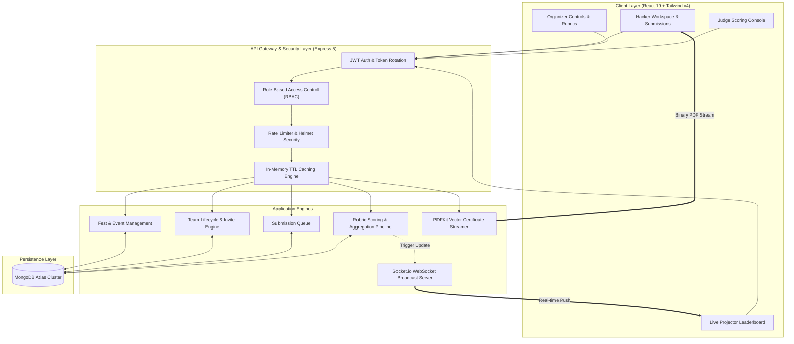

# StageZero &mdash; Campus Fest & Hackathon Operating System

> **Where every hackathon team and campus event starts.**  
> An end-to-end, real-time campus competition management platform powering multi-track engineering fests, automated team formation, rubric-based judge evaluations, live projector leaderboards, and on-the-fly streaming certificate generation.

---

## 1. Problem Statement

College hackathons and campus engineering fests face acute operational fragmentation:
- **Disorganized Registration & Squad Formation**: Participants struggle with uncoordinated spreadsheets, mismatched team sizes, and manual invite links.
- **Biased, Flawed Scoring**: Judges often use arbitrary scoring scales or paper rubrics with missing entries silently defaulting to inflated scores, corrupting leaderboard fairness.
- **Delayed & Manual Leaderboards**: Organizers manually tally spreadsheets while participants wait hours to see if they advanced to the next round.
- **Administrative Cross-Contamination**: In multi-fest platforms, organizers often accidentally modify or view competing college events due to weak authorization boundaries.
- **Certificate Distribution Nightmares**: Generating, naming, and emailing hundreds of participant and winner certificates takes days of manual effort after the fest.

---

## 2. Target Users

1. **Participants / Hackers**: College students and developers looking to discover upcoming campus symposiums, create squads with unique invite codes, submit GitHub repos/demo URLs, and track live rankings.
2. **Fest Organizers**: Campus leads and club heads who host symposiums, create competitive tracks, configure multi-criteria weighted rubrics, manage team check-ins, and broadcast urgent real-time announcements.
3. **Judges & Evaluators**: Industry mentors and faculty who evaluate projects against strict rubrics, ensuring completeness before submitting verified scorecards.
4. **Platform Superadmins**: Root administrators overseeing platform integrity across universities.

---

## 3. The Solution

**StageZero** provides a unified, reactive operating system that replaces spreadsheets, Discord chaos, and manual scoring with a single cohesive platform:
- **2-Step Role-Tailored Onboarding**: Dedicated registration pathways for Hackers, Organizers, and Judges with role-specific verification and badge authentication.
- **Strict Role-Based Isolation (RBAC)**: Organizers can **only** view and operate events for fests they created; judges evaluate only assigned competitions; participants discover opportunities campus-wide.
- **Real-Time Projector Leaderboard**: A high-speed, TV-ready live leaderboard powered by MongoDB aggregation pipelines and real-time Socket.io push broadcasts.
- **Uncompromising Scoring Integrity**: Every criterion must be explicitly scored; missing scores remain visibly unscored and block submission to prevent silent grade inflation.
- **Instant Vector PDF Certificate Streaming**: High-resolution, tamper-evident certificates generated on-the-fly via Node.js streams directly to participants.

---

## 4. Key Workflows

### Workflow 1: Role-Tailored Registration & Multi-Fest Discovery
1. The user visits StageZero and enters the role-selection gateway (Hacker, Organizer, or Judge).
2. The registration form dynamically morphs to capture relevant metadata (e.g. GitHub URL for hackers, university affiliation for organizers, professional designation & judge invite code for judges).
3. Upon authentication (HttpOnly JWT cookie + access token), participants browse all upcoming campus symposiums, filter by status (Live, Upcoming, Completed), and search across universities.
4. Organizers are routed to their personal workspace view displaying only fests they manage.

### Workflow 2: Team Formation, Invite Codes & Check-In
1. A hacker creates a squad for a track, setting a unique team name and bio.
2. The platform generates an invite code (e.g. `STG-7X9K2`) enforced against track team-size constraints (e.g. 2–4 members).
3. Teammates enter the code to join instantly; team leaders can manage squad rosters.
4. On event day, the organizer dashboard provides instant one-click toggle check-in for physical/virtual attendance tracking.

### Workflow 3: Project Submission
1. Once checked in, the team unlocks the submission portal.
2. The leader submits the project title, tagline, description, GitHub repository URL, and live demo link before the round deadline.
3. The submission is queued in real-time into the assigned judges' evaluation rosters.

### Workflow 4: Rubric Evaluation & Live Scoring Engine
1. Authorized judges open the **Judge Scoring Console** (`/events/:id/judge`).
2. Submissions appear in a split-screen workbench with project links and interactive rubric sliders.
3. Criteria enforce strict boundaries ($0 \le score \le maxScore$) and require 100% completion before publishing.
4. Upon submission, MongoDB executes an aggregation pipeline weighting each criterion:
   $$\text{Total Score} = \sum (\text{criterion score} \times \text{weight})$$
5. The updated ranking is broadcast instantaneously to all connected projector screens via Socket.io.

### Workflow 5: Instant Vector PDF Certificate Streaming
1. Once an event concludes, participants and winners can download official credentials.
2. The server streams a vector-rendered PDF certificate directly over HTTP (using PDFKit) featuring team details, college crest, verification ID, and official organizer signatures.

---

## 5. Technology Stack & Engineering Decisions

| Layer | Technology | Engineering Rationale |
| :--- | :--- | :--- |
| **Frontend Framework** | **React 19 + Vite** | Instant HMR development and fast client hydration. |
| **Routing & Code-Splitting**| **React Router v7** | Route-level lazy loading (`React.lazy` + `Suspense`) keeping the initial bundle light. |
| **Styling & Design System**| **Tailwind CSS v4** | Clean Precision layout (75%) paired with Campus Neubrutalism (15%) for high contrast. |
| **Backend Runtime** | **Node.js (ESM) + Express 5** | High-concurrency event-driven asynchronous I/O. |
| **Database & ODM** | **MongoDB Atlas + Mongoose 9** | Flexible document modeling for dynamic multi-round rubrics and complex aggregations. |
| **Real-time Engine** | **Socket.io** | Bidirectional WebSocket communication for instant projector updates and emergency announcements. |
| **Document Generation** | **PDFKit** | On-the-fly streaming binary vector graphics without saving temporary files to disk. |
| **Authentication & RBAC** | **JWT + HttpOnly Cookies** | Secure token rotation with stateless verification and defense against XSS. |
| **Validation** | **Zod** | Strict schema validation guarding API entry points against malformed inputs. |

---

## 6. System Architecture



---

## 7. Role-Based Access Control (RBAC) Matrix

| Action / Capability | Participant | Fest Organizer | Event Judge | Superadmin |
| :--- | :---: | :---: | :---: | :---: |
| Browse All Campus Fests | :white_check_mark: | :lock: *(Own Only)* | :white_check_mark: | :white_check_mark: |
| Host New Fest | :x: *(403)* | :white_check_mark: | :x: *(403)* | :white_check_mark: |
| Create Competitive Tracks / Events | :x: *(403)* | :white_check_mark: *(Own Fest)* | :x: *(403)* | :white_check_mark: |
| Edit Event Rubric & Deadlines | :x: *(403)* | :white_check_mark: *(Own Fest)* | :x: *(403)* | :white_check_mark: |
| Assign Judges to Events | :x: *(403)* | :white_check_mark: *(Own Fest)* | :x: *(403)* | :white_check_mark: |
| Toggle Team Check-In | :x: *(403)* | :white_check_mark: *(Own Fest)* | :x: *(403)* | :white_check_mark: |
| Broadcast Live Announcements | :x: *(403)* | :white_check_mark: *(Own Fest)* | :x: *(403)* | :white_check_mark: |
| Create Team & Generate Invite Code | :white_check_mark: | :x: | :x: | :white_check_mark: |
| Submit Project Code & Demos | :white_check_mark: | :x: | :x: | :white_check_mark: |
| Evaluate Submissions | :x: *(403)* | :x: *(403)* | :white_check_mark: *(Assigned Only)* | :white_check_mark: |
| View Live Projector Leaderboard | :white_check_mark: | :white_check_mark: *(Own Fest)* | :white_check_mark: | :white_check_mark: |
| Download Verified PDF Certificate | :white_check_mark: | :white_check_mark: | :white_check_mark: | :white_check_mark: |

---

## 8. Local Setup & Installation

### Prerequisites
- **Node.js**: v18.0.0 or higher
- **npm**: v9.0.0 or higher
- **MongoDB**: Local MongoDB instance or free MongoDB Atlas cluster

### 1. Clone the Repository
```bash
git clone https://github.com/sanyam2509-tech/StageZero.git
cd StageZero
```

### 2. Configure Backend Environment
Navigate to `backend/` and configure your `.env` from the provided example:
```bash
cd backend
cp .env.example .env
```
Ensure your `backend/.env` has the following variables:
```env
PORT=8000
MONGO_URI=mongodb://127.0.0.1:27017/festflow
CORS_ORIGIN=http://localhost:5173
NODE_ENV=development
ACCESS_TOKEN_SECRET=festflow_super_secret_access_jwt_key_2026_dev_mode
ACCESS_TOKEN_EXPIRY=1d
REFRESH_TOKEN_SECRET=festflow_super_secret_refresh_jwt_key_2026_dev_mode
REFRESH_TOKEN_EXPIRY=10d
```

### 3. Install Dependencies & Seed Sample Data
```bash
npm install
npm run seed     # Populates sample fests (Yugaantar), events, and verified demo accounts
npm start        # Launches backend on http://localhost:8000
```

### 4. Configure Frontend Client
In a separate terminal, navigate to `frontend/`:
```bash
cd frontend
cp .env.example .env
npm install
npm run dev      # Launches client on http://localhost:5173
```

---

## 9. Demo Credentials for Evaluation

The database comes pre-seeded with dedicated accounts for each tier:

| Role | Email | Password | Primary Capabilities |
| :--- | :--- | :--- | :--- |
| **Fest Organizer** | `organizer@demo.com` | `demo123456` | Host fests, configure rubrics, assign judges, check-in squads. |
| **Lead Judge** | `judge@demo.com` | `demo123456` | Rubric scoring console, score validation, feedback entry. |
| **Hacker / Participant** | `participant@demo.com` | `demo123456` | Squad formation, invite codes, code submission, certificate download. |
| **Root Superadmin** | `superadmin@stagezero.io` | `demo123456` | Global unrestricted visibility and platform governance. |

---

## 10. Performance Benchmarks

- **Health Check Response Time**: `~11 ms`
- **Cached Fest Discovery**: `~1 ms` (via 20s in-memory TTL caching engine)
- **Live Leaderboard Aggregation**: `< 90 ms` (MongoDB multi-stage pipeline)
- **Production JavaScript Bundle**: Route-split with primary vendor chunk `< 126 kB` gzipped.

---

## License
Distributed under the ISC License. See `LICENSE` for more information.
